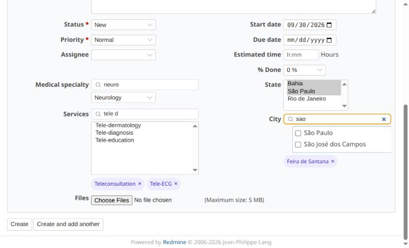
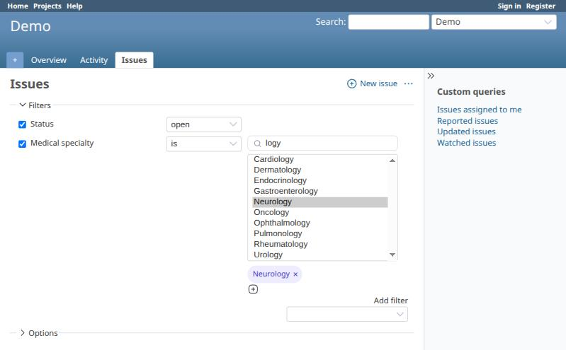
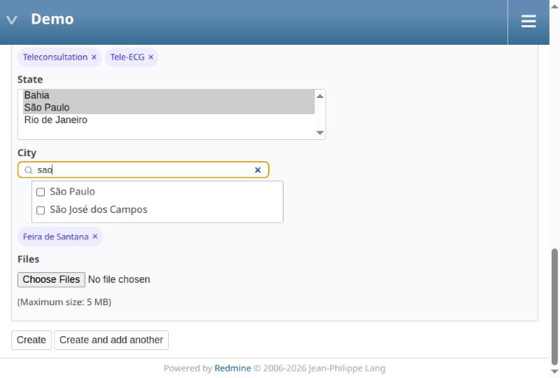

# Redmine Searchable Custom Fields

This plugin adds a search box to long list custom fields, so users can find an option by typing part of its name.

[Português (Brasil)](README.pt-BR.md)

## What's new

* 0.1.0: First release. See [CHANGELOG](CHANGELOG.md).

## Features

* Adds a search box to **list custom fields** with many options:
  * single-value selects (typing selects the first match),
  * multiple-value selects,
  * checkbox groups ("Display: check boxes").
* **Accent-, case- and punctuation-insensitive**, word by word, in any order:
  `sao jose` finds *São José dos Campos*, `campos jose` too, `tele d` finds *Tele-diagnosis*.
* **Keeps the native field**: nothing is replaced, so forms, bulk edit and Redmine's own JavaScript keep working.
* **Works with cascading fields** of [Redmine Depending Custom Fields](https://github.com/jcatrysse/redmine_depending_custom_fields):
  options hidden by the parent value stay hidden, and the box tells the user what is going on
  ("Select the parent field first" / "No options for the current selection").
* **Keeps still-valid selections** of cascading fields: with Depending Custom Fields 0.0.14/0.0.15, removing a parent
  value (or going back to a combination seen before) clears child values that are still allowed. This plugin keeps them.
  Can be disabled.
* Selected values of multiple-value fields are shown as **chips** with a remove button, even when the search is hiding them.
* **Click to toggle** in multiple-value selects (no Ctrl needed). Can be disabled.
* Also works in the **issue list filters** (including filters added later and the multi-select toggle) and in **bulk edit**.
* Translated into 10 languages: English, Portuguese (Brazil), Portuguese (Portugal), Spanish, French, Italian, German, Russian, Japanese and Chinese (Simplified).

## Screenshots

### Issue form
Single value, multiple values with chips, and a cascading field (State → City) searched without accents.

### Issue list filter

### Small screens

## Required Redmine version

* 4.2.x ~ 6.1.x

Tested on clean installations (official Docker images, SQLite), in the issue form, the issue list filters
and, from 5.0 on, together with Redmine Depending Custom Fields 0.0.14:

| Redmine | Rails | Ruby | Depending Custom Fields |
|---|---|---|---|
| 6.1.4 | 7.2.3.2 | 3.4.11 | ✔ |
| 6.0.11 | 7.2.3.2 | 3.3.12 | ✔ |
| 6.0.5 | 7.2.2.1 | 3.3.8 | ✔ (MySQL) |
| 5.1.12 | 6.1.7.10 | 3.2.11 | ✔ |
| 5.0.12 | 6.1.7.10 | 3.1.7 | ✔ |
| 4.2.10 | 5.2.8.1 | 2.7.8 | – (that plugin requires Redmine 5.0+) |

No database migrations, no gems, no external JavaScript libraries.

## Install

1. Move to the `plugins` folder of your Redmine.
<pre>
git clone --branch v0.1.0 https://github.com/cerqueirav/redmine_searchable_custom_fields.git
</pre>
2. Restart Redmine.

## Configuration

*Administration → Plugins → Redmine Searchable Custom Fields → Configure*

| Setting | Default | Description |
|---|---|---|
| Minimum number of options | 10 | The search box is only added to lists with at least this many options (2 to 1000). |
| Click to toggle | on | In multiple-value selects, a single click selects/deselects an option. |
| Keep valid selections | on | Depending Custom Fields: when the parent field changes, keep the child values that are still allowed. |

To enable the search on any other `<select>` of your own views, add `data-searchable="true"` to it.

## Uninstall

1. Remove the `plugins/redmine_searchable_custom_fields` folder.
2. Restart Redmine.

## Author

Victor Cerqueira — dev.cerqueirav@gmail.com

## License

GNU General Public License v3.0 or later. See [LICENSE](LICENSE).

If you modify and distribute this plugin, keep the copyright notices, state your changes and
distribute your version under the same license.
